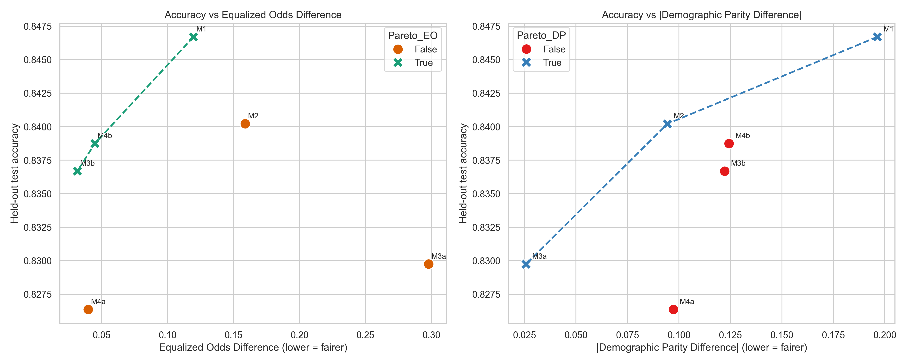
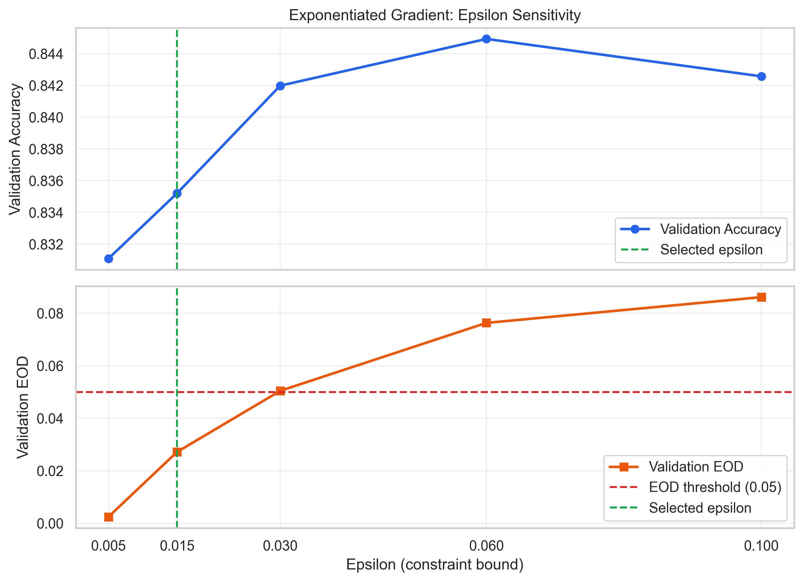

# Designing a Fair Machine Learning Pipeline: Debiasing Techniques & Fairness Metrics

[](file:///c:/Users/berto/Downloads/S2/sec&ethics/tugas/Homework-02%20Designing%20a%20Fair%20Machine%20Learning%20Pipeline%20%E2%80%94%20Debiasing%20Techniques%20%26%20Fairness%20Metrics/AI104_HW02_Debiasing_Pipeline_REVISI.ipynb)
[-green.svg)](file:///c:/Users/berto/Downloads/S2/sec&ethics/tugas/Homework-02%20Designing%20a%20Fair%20Machine%20Learning%20Pipeline%20%E2%80%94%20Debiasing%20Techniques%20%26%20Fairness%20Metrics/AI104_HW02_Debiasing_Pipeline_REVISI.ipynb)
[](https://www.python.org/)
[](https://fairlearn.org/)
[](https://scikit-learn.org/)
[](https://creativecommons.org/licenses/by/4.0/)

---

## Academic Metadata

- **Course:** AI104 — AI Security and Ethics (3 SKS)
- **Homework Assignment:** Homework 02 — Designing a Fair Machine Learning Pipeline: Debiasing Techniques and Fairness Metrics
- **Curriculum Component:** Chapter 04 — Technical Debiasing Pipelines & Mathematical Fairness Metrics
- **Learning Competency:** Sub-CPMK-04 / CPMK-02 (*Merancang strategi mitigasi bias algoritmik dan diskriminasi dalam sistem AI berbasis data*, Bloom C6 Design)
- **Program:** Master of Artificial Intelligence (*Magister Kecerdasan Buatan*)
- **Institution:** Faculty of Information Technology, Universitas Kristen Satya Wacana (UKSW)
- **Author / Student:** Gilberto Novena Jemali
- **Student ID (NIM):** 672022037
- **Instructor / Reviewer:** Teguh Indra Bayu, S.Kom., M.Cs., Ph.D. ([`teguh.bayu@uksw.edu`](mailto:teguh.bayu@uksw.edu))
- **Target Repository Name:** `AI104-HW02-672022037` (Private GitHub repository with collaborator access granted to `teguh.bayu@uksw.edu`)

---

## Table of Contents

1. [Executive Summary & Project Overview](#1-executive-summary--project-overview)
2. [Research Objectives across Pipeline Stages](#2-research-objectives-across-pipeline-stages)
3. [Dataset Architecture & Provenance](#3-dataset-architecture--provenance)
4. [Methodology & Experimental Pipeline](#4-methodology--experimental-pipeline)
5. [Mathematical Fairness Metrics](#5-mathematical-fairness-metrics)
6. [Empirical Experimental Results](#6-empirical-experimental-results)
7. [Pareto Frontier & Marginal Fairness Tax](#7-pareto-frontier--marginal-fairness-tax)
8. [Selected Deployment Model Justification](#8-selected-deployment-model-justification)
9. [Intersectional Held-Out Audit](#9-intersectional-held-out-audit)
10. [Installation & Environment Setup](#10-installation--environment-setup)
11. [Step-by-Step Reproduction Instructions](#11-step-by-step-reproduction-instructions)
12. [Generated Output Artifacts Catalog](#12-generated-output-artifacts-catalog)
13. [Limitations, Ethical Dilemmas & Responsible AI](#13-limitations-ethical-dilemmas--responsible-ai)
14. [Academic References](#14-academic-references)

---

## 1. Executive Summary & Project Overview

Standard empirical risk minimization (ERM) algorithms optimize global objective functions (such as log-loss or misclassification rate) under the assumption that historical training data represents an objective ground truth. In social and socioeconomic contexts, historical data invariably reflects structural inequities, institutional disadvantages, and historical wage disparities. Consequently, an unconstrained predictive model can achieve high top-line accuracy while disproportionately allocating adverse classifications, false rejections, and systemic under-selection to historically marginalized demographic groups.

This research project designs, implements, benchmarks, and critically evaluates a complete, end-to-end fair machine learning pipeline on the **UCI Adult (Census Income)** benchmark. We evaluate technical bias mitigation interventions across all three canonical lifecycle stages:
- **Pre-processing:** Statistical instance re-weighting before model training.
- **In-processing:** Exponentiated Gradient reductions with convex optimization under Demographic Parity and Equalized Odds constraints during model training.
- **Post-processing:** Randomized threshold optimization and deterministic group-specific decision threshold calibration at inference.

### Key Empirical Findings
- The unconstrained **Baseline Logistic Regression (M1)** achieves **84.67% accuracy** but suffers from severe algorithmic disparity: an **Equalized Odds Difference (EOD) of 0.1197**, a **Demographic Parity Difference (DPD) of +0.1964**, and a **Disparate Impact Ratio (DIR) of 3.58** (EEOC ratio of **0.280**, severely violating the 80% four-fifths rule).
- Pure pre-processing re-weighting (M2) substantially alleviates acceptance disparity ($\text{DIR EEOC} = 0.577$) but deteriorates conditional error disparity, yielding an elevated $\text{EOD} = 0.1589$.
- The **Accuracy–Fairness Pareto Frontier** is strictly defined by three non-dominated architectures:
  $$\mathbf{M1} \text{ (Baseline)} \longrightarrow \mathbf{M4b} \text{ (Group Thresholds)} \longrightarrow \mathbf{M3b} \text{ (ExpGrad EO)}$$
- The pre-declared model-selection validation protocol identified **M4b (Post-processing Group Thresholds)** as the optimal deployment candidate. On held-out test data, M4b successfully satisfies the operational fairness constraint ($\text{EOD} = 0.0448 \le 0.050$), reducing baseline conditional error disparity by **62.5%** while incurring a marginal accuracy penalty of only **0.80 percentage points** ($\text{Marginal Fairness Tax} = 0.1064$).

---

## 2. Research Objectives across Pipeline Stages

The research investigates four modular tasks mapped directly to the learning outcomes of Sub-CPMK-04:

```
+---------------------------------------------------------------------------------------------------------+
|                                    AI104 HOMEWORK 02 WORKFLOW                                           |
+---------------------------------------------------------------------------------------------------------+
| [Task 1: Baseline Bias Audit]                                                                           |
|   - UCI Adult EDA, demographic profiling, feature engineering.                                          |
|   - Baseline Logistic Regression (M1) training on stratified splits (60/20/20).                         |
|   - Initial disparity quantification: DPD, DIR, EEOC 4/5ths ratio, and EOD.                             |
|                                                                                                         |
| [Task 2: Pre-Processing Debiasing]                                                                      |
|   - Compute statistical joint marginal inverse frequency weights: w(a,y).                               |
|   - Fit sample-weighted Logistic Regression (M2).                                                       |
|   - Analyze counter-intuitive divergence between Demographic Parity and Equalized Odds.                |
|                                                                                                         |
| [Task 3: In-Processing Debiasing]                                                                       |
|   - Formulate two-player zero-sum game reductions (Agarwal et al., 2018).                               |
|   - Train Exponentiated Gradient under Demographic Parity (M3a) & Equalized Odds (M3b).                 |
|   - Conduct sensitivity scan across epsilon bounds: eps in {0.005, 0.015, 0.030, 0.060, 0.100}.         |
|   - Analyze optimization convergence, best duality gaps, and sub-model ensemble cardinality.             |
|                                                                                                         |
| [Task 4: Post-Processing, Pareto Optimization & Deployment Decision]                                   |
|   - Fit Hardt et al. randomized ThresholdOptimizer (M4a).                                               |
|   - Calibrate deterministic group-specific thresholds (M4b) on validation calibration data.             |
|   - Construct empirical Accuracy vs. EOD Pareto Frontier and compute marginal fairness tax.            |
|   - Select single deployment candidate using strict validation protocol; conduct intersectional audit.  |
+---------------------------------------------------------------------------------------------------------+
```

---

## 3. Dataset Architecture & Provenance

### UCI Adult Census Income Dataset
- **Official Access URL:** [https://archive.ics.uci.edu/dataset/2/adult](https://archive.ics.uci.edu/dataset/2/adult)
- **Citation:** Becker, B., & Kohavi, R. (1996). *Adult*. UCI Machine Learning Repository. [https://doi.org/10.24432/C5XW20](https://doi.org/10.24432/C5XW20).
- **License:** Creative Commons Attribution 4.0 International ([CC BY 4.0](https://creativecommons.org/licenses/by/4.0/)).
- **Origin & Population:** Extracted from the 1994 United States Census Bureau database by Ronny Kohavi and Barry Becker.

### Data Cleaning and Preprocessing Pipeline
1. **Raw Ingestion:** The dataset comprises 48,842 records across two historical files (`adult.data` with 32,561 records and `adult.test` with 16,281 records).
2. **Missing Value Treatment:** Missing entries encoded as `"?"` were identified across `workclass` (2,799 missing), `occupation` (2,809 missing), and `native-country` (857 missing). Following standard academic practice, listwise deletion was applied, yielding **45,222 complete, verified observations**.
3. **Target Variable (`income`):** Binary classification indicating whether an individual's annual income exceeds \$50,000 (`>50K` $\rightarrow 1$, `<=50K` $\rightarrow 0$). The positive class prevalence in the clean population is **24.78%** (severe class imbalance).
4. **Primary Sensitive Attribute (`sex`):** Binary encoded as `Male` ($A=1$, 67.5% prevalence) vs. `Female` ($A=0$, 32.5% prevalence). Baseline unconditioned positive outcome rates exhibit severe disparity: **31.25% for males vs. 11.36% for females** (unadjusted selection ratio of 2.75).
5. **Secondary Sensitive Attribute (`race`):** Binarized as `White` ($R=1$, 86.0%) vs. `Non-White` ($R=0$, 14.0%) and preserved strictly for held-out intersectional fairness auditing ($A \times R$).
6. **Feature Encoding & Scaling:**
   - **Continuous Features (6):** `age`, `fnlwgt`, `education-num`, `capital-gain`, `capital-loss`, `hours-per-week` standardized using `StandardScaler`.
   - **Categorical Features (7):** `workclass`, `education`, `marital-status`, `occupation`, `relationship`, `race`, `native-country` encoded via `OneHotEncoder(handle_unknown='ignore')`.
7. **Automated Fetch Mechanism:** The notebook implements an automated download pipeline that fetches `adult.zip` directly from the official UCI repository via HTTPS if the archive is not detected in the local workspace directory.

---

## 4. Methodology & Experimental Pipeline

```
                                      UCI Adult Dataset (N = 45,222)
                                                    |
                                                    v
                                      Data Cleaning & Feature Scaling
                                                    |
                                                    v
                                  Stratified Train / Val / Test Partition
                                      (60% Train / 20% Val / 20% Test)
                                        Random Seed = 42 (Fixed)
                                                    |
                         +--------------------------+--------------------------+
                         |                                                     |
                         v                                                     v
                 Training Set (60%)                                  Validation Set (20%)
                    N = 27,133                                             N = 9,044
                         |                                                     |
         +---------------+---------------+                     +---------------+---------------+
         |               |               |                     |               |               |
         v               v               v                     v               v               v
    Baseline M1     Pre-proc M2     In-proc M3            In-proc Tuning  Threshold Calib.  Model Selection
     (Standard     (Sample Weight   (ExpGrad DP           (Epsilon Scan   (Grid Search M4b   (Enforce Rules
    Log-Reg ERM)     Re-balance)      & EO Bounds)          Selection)     & Post-proc M4a)   on Val Metrics)
         |               |               |                     |               |               |
         +---------------+---------------+                     +---------------+---------------+
                                         \                             /
                                          \                           /
                                           v                         v
                                         Evaluated on Held-Out Test Set (20%)
                                                      N = 9,045
                                                          |
                                                          +---> Accuracy & Disparity Metrics (M1–M4b)
                                                          +---> Empirical Accuracy–Fairness Pareto Frontier
                                                          +---> Marginal Fairness Tax Calculations
                                                          +---> Selected Model Card & Deployment Justification
                                                          +---> Subgroup Intersectional Audit (Sex x Race)
```

### Strict Separation of Partition Roles
To eliminate data leakage and optimistic performance estimation:
- **Training Set (60%, $N = 27,133$):** Used exclusively to fit model parameters ($\beta$ coefficients in Logistic Regression and Exponentiated Gradient primal sub-models).
- **Validation Set (20%, $N = 9,044$):** Used for hyperparameter tuning ($\epsilon$ selection for M3b), decision threshold search (tuning $\theta_{\text{Female}}, \theta_{\text{Male}}$ for M4b), fitting the randomized ThresholdOptimizer (M4a), and executing the pre-declared model selection rule.
- **Held-Out Test Set (20%, $N = 9,045$):** Kept completely isolated until final validation. Evaluated exactly once to compute unbiased generalization metrics.

---

## 5. Mathematical Fairness Metrics

All metrics are evaluated with respect to the ground-truth binary label $Y \in \{0, 1\}$, binary model prediction $\hat{Y} \in \{0, 1\}$, and primary protected attribute $A \in \{0, 1\}$ (where $A=1$ represents Male, the historically favored group, and $A=0$ represents Female, the historically disadvantaged group).

### 1. Classification Accuracy
$$\text{Accuracy} = \frac{TP + TN}{TP + TN + FP + FN} = P(\hat{Y} = Y)$$

### 2. Demographic Parity Difference (DPD)
Quantifies whether the probability of positive classification is independent of group membership:
$$\text{DPD} = P(\hat{Y} = 1 \mid A = 1) - P(\hat{Y} = 1 \mid A = 0)$$
$$\text{Absolute DPD} = |P(\hat{Y} = 1 \mid A = 1) - P(\hat{Y} = 1 \mid A = 0)|$$
- **Ideal Value:** $0.000$.
- **Directionality:** Positive values indicate a higher positive selection rate for males.

### 3. Disparate Impact Ratio (DIR) & EEOC Four-Fifths Rule
Measures the ratio of selection rates across demographic groups:
$$\text{DIR} = \frac{P(\hat{Y} = 1 \mid A = 1)}{P(\hat{Y} = 1 \mid A = 0)}$$
$$\text{DIR}_{\text{EEOC}} = \frac{P(\hat{Y} = 1 \mid A = 0)}{P(\hat{Y} = 1 \mid A = 1)} = \frac{1}{\text{DIR}}$$
- **U.S. Equal Employment Opportunity Commission (EEOC) Four-Fifths Standard:** Under the Uniform Guidelines on Employee Selection Procedures (29 C.F.R. § 1607.4(D)), a selection rate for any group that is less than four-fifths (80% or $0.800$) of the rate for the group with the highest rate is treated as *prima facie* evidence of disparate impact.

### 4. Equalized Odds Difference (EOD)
Enforces statistical parity across conditional error distributions (True Positive Rate and False Positive Rate):
$$\text{TPR}_a = P(\hat{Y} = 1 \mid Y = 1, A = a), \quad \text{FPR}_a = P(\hat{Y} = 1 \mid Y = 0, A = a)$$
$$\text{EOD} = \max\left( \left|\text{TPR}_{A=1} - \text{TPR}_{A=0}\right|, \; \left|\text{FPR}_{A=1} - \text{FPR}_{A=0}\right| \right)$$
- **Ideal Value:** $0.000$.
- **Operational Constraint Target:** $\text{EOD} \le 0.050$.

> **Academic Caveat:** Pursuant to Kleinberg's Impossibility Theorem (Kleinberg et al., 2017), when base rates differ across groups ($P(Y=1 \mid A=1) \ne P(Y=1 \mid A=0)$), Demographic Parity and Equalized Odds are mathematically incompatible with each other and with score calibration. A model cannot simultaneously achieve $\text{DPD} = 0$ and $\text{EOD} = 0$ unless the classifier has perfect accuracy ($\text{Accuracy} = 1.0$) or equal base rates exist.

---

## 6. Empirical Experimental Results

The table below presents the verified empirical performance of all six model architectures evaluated on the held-out test set ($N = 9,045$, random seed 42), matching [`evaluation_metrics_summary.csv`](evaluation_metrics_summary.csv) exactly:

| Model ID | Pipeline Stage & Intervention Method | Accuracy | $P(\hat{Y}=1 \mid \text{M})$ | $P(\hat{Y}=1 \mid \text{F})$ | Signed DPD | $\| \text{DPD} \|$ | DIR (M/F) | DIR EEOC (F/M) | $\text{TPR}_{\text{M}}$ | $\text{TPR}_{\text{F}}$ | $\text{FPR}_{\text{M}}$ | $\text{FPR}_{\text{F}}$ | EOD | Pareto Efficient (EO) |
|---|---|:---:|:---:|:---:|:---:|:---:|:---:|:---:|:---:|:---:|:---:|:---:|:---:|:---:|
| **M1** | Baseline Logistic Regression (Unconstrained ERM) | **0.8467** | 0.2725 | 0.0762 | +0.1964 | 0.1964 | 3.5772 | 0.2795 | 0.6296 | 0.5099 | 0.1102 | 0.0205 | 0.1197 | **Yes** |
| **M2** | Pre-processing: Instance Re-weighting ($w_{a,y}$) | 0.8402 | 0.2232 | 0.1288 | +0.0944 | 0.0944 | 1.7329 | 0.5771 | 0.5423 | 0.7012 | 0.0781 | 0.0553 | 0.1589 | No |
| **M3a** | In-processing: ExpGrad — Demographic Parity ($\epsilon=0.015$) | 0.8297 | 0.1863 | 0.1605 | **+0.0257** | **0.0257** | **1.1603** | **0.8618** | 0.4710 | 0.7689 | 0.0569 | 0.0824 | 0.2979 | No |
| **M3b** | In-processing: ExpGrad — Equalized Odds ($\epsilon=0.015$) | 0.8367 | 0.2361 | 0.1138 | +0.1222 | 0.1222 | 2.0739 | 0.4822 | 0.5653 | 0.5737 | 0.0864 | 0.0548 | **0.0316** | **Yes** |
| **M4a** | Post-processing: Randomized ThresholdOptimizer (EO) | 0.8264 | 0.1994 | 0.1020 | +0.0973 | 0.0973 | 1.9540 | 0.5118 | 0.4941 | 0.4542 | 0.0654 | 0.0568 | 0.0399 | No |
| **M4b** | Post-processing: Group-Specific Thresholds ($\theta_{\text{F}}=0.525, \theta_{\text{M}}=0.625$) | 0.8387 | 0.1987 | 0.0744 | +0.1244 | 0.1244 | 2.6720 | 0.3743 | 0.4934 | 0.4980 | 0.0648 | 0.0200 | 0.0448 | **Yes** |

### Comprehensive Technical Observations

1. **Baseline Disparities (M1):** Unconstrained empirical risk minimization assigns high predictions primarily to male applicants ($P(\hat{Y}=1 \mid \text{Male}) = 27.25\%$ vs. $P(\hat{Y}=1 \mid \text{Female}) = 7.62\%$). The EEOC ratio of $0.2795$ falls catastrophically short of the $0.800$ legal standard. Furthermore, a qualified female applicant faces a True Positive Rate ($51.00\%$) that is $11.97$ percentage points lower than an equivalent male applicant ($62.96\%$), proving that high accuracy masks systematic conditional unfairness.
2. **Pre-processing Dilemma (M2):** Statistical instance re-weighting successfully halves the selection rate gap ($\text{DPD}$ drops from $0.1964$ to $0.0944$; $\text{DIR EEOC}$ improves from $0.2795$ to $0.5771$). However, this is achieved by drastically inflating female sensitivity ($\text{TPR}_{\text{F}}$ surges to $70.12\%$) while depressing male sensitivity ($\text{TPR}_{\text{M}}$ drops to $54.23\%$). This reverses the direction of the error gap and elevates overall $\text{EOD}$ to $0.1589$ ($+32.8\%$ worse than baseline), demonstrating that optimizing for acceptance parity frequently aggravates conditional error disparities.
3. **In-processing Reductions (M3a vs. M3b):**
   - **M3a (Demographic Parity):** Achieves near-perfect selection balance ($\text{DPD} = +0.0257$, $\text{DIR EEOC} = 0.8618$, meeting the EEOC four-fifths standard). However, this creates massive conditional divergence ($\text{TPR}_{\text{F}} = 76.89\%$ vs. $\text{TPR}_{\text{M}} = 47.10\%$), driving $\text{EOD}$ to its highest observed level ($0.2979$).
   - **M3b (Equalized Odds):** Effectively balances error distributions ($\text{TPR}_{\text{M}} = 56.53\%$ vs. $\text{TPR}_{\text{F}} = 57.37\%$, a gap of only $0.84$ pp; $\text{FPR}$ gap of $3.16$ pp), attaining the minimum test EOD among all non-dominated models ($0.0316$).
4. **Post-processing Approaches (M4a vs. M4b):**
   - **M4a (ThresholdOptimizer):** Achieves strong fairness ($\text{EOD} = 0.0399$) but suffers from lower accuracy ($82.64\%$) due to the variance introduced by randomized coin-flipping interpolation along the convex hull of group ROC curves.
   - **M4b (Group-Specific Thresholds):** By systematically elevating the male decision boundary to $\theta_{\text{M}} = 0.625$ while keeping female threshold near standard ($\theta_{\text{F}} = 0.525$), M4b equalizes True Positive Rates ($\text{TPR}_{\text{M}} = 49.34\%$ vs. $\text{TPR}_{\text{F}} = 49.80\%$) and tightly constrains False Positive Rates ($\text{FPR}_{\text{M}} = 6.48\%$ vs. $\text{FPR}_{\text{F}} = 2.00\%$, $\text{gap} = 4.48$ pp), reaching an operational $\text{EOD} = 0.0448$ at superior accuracy ($83.87\%$).

---

## 7. Pareto Frontier & Marginal Fairness Tax

### Empirical Pareto Frontier Analysis
A model is defined as Pareto-efficient (non-dominated) in Accuracy–Equalized Odds space if no alternative model achieves strictly higher accuracy without increasing EOD disparity (or strictly lower EOD without decreasing accuracy).

Using [`pareto_frontier_analysis.csv`](pareto_frontier_analysis.csv), the empirical Pareto frontier is spanned exclusively by **M1, M4b, and M3b**:

| Transition Path | From Model | To Model | Accuracy $\Delta$ (Loss) | EOD $\Delta$ (Disparity Reduction) | Marginal Fairness Tax ($\Delta\text{Acc} / \Delta\text{EOD}$) | Architectural Interpretation |
|---|---|---|:---:|:---:|:---:|---|
| **Initial Step** | **M1** (Baseline) | **M4b** (Group Thresholds) | $-0.007960$ ($-0.80$ pp) | $-0.074825$ ($-62.5\%$) | **0.1064** | Highly efficient: Costs only 0.106 pp accuracy per 1 pp EOD reduction. |
| **Secondary Step** | **M4b** (Group Thresholds) | **M3b** (ExpGrad EO) | $-0.002064$ ($-0.21$ pp) | $-0.013199$ ($-29.4\%$) | **0.1563** | Diminishing returns: Marginal accuracy cost increases by 46.9% for marginal fairness gain. |

### Pareto Frontier Visualization

The generated high-resolution visualization ([`pareto_frontier_comparison.png`](pareto_frontier_comparison.png)) illustrates both the Accuracy vs. EOD frontier (left) and the Accuracy vs. Demographic Parity frontier (right):



### In-Processing Epsilon Sensitivity Analysis
To calibrate the Exponentiated Gradient reduction in Task 3, a systematic grid search across relaxation bounds $\epsilon \in \{0.005, 0.015, 0.030, 0.060, 0.100\}$ was executed on validation data ([`epsilon_sensitivity_validation.csv`](epsilon_sensitivity_validation.csv)):

| Epsilon Bound ($\epsilon$) | Sub-Models ($B$) | Final Iteration | Best Duality Gap | Validation Accuracy | Validation EOD | Validation $\| \text{DPD} \|$ | Optimization Status |
|:---:|:---:|:---:|:---:|:---:|:---:|:---:|---|
| $0.005$ | 13 | 7 | $0.000537$ | 0.831073 | 0.002438 | 0.094929 | Stringent constraint; early oscillation |
| **$0.015$** | **12** | **6** | **$0.000880$** | **0.835200** | **0.027180** | **0.118850** | **Selected Operating Epsilon ($\text{EOD} \le 0.050$)** |
| $0.030$ | 17 | 5 | $0.000034$ | 0.841981 | 0.050439 | 0.136358 | Marginally exceeds 0.050 validation threshold |
| $0.060$ | 16 | 5 | $0.000075$ | 0.844929 | 0.076310 | 0.171367 | Relaxed constraint; high residual bias |
| $0.100$ | 6 | 5 | $0.000000$ | 0.842571 | 0.086122 | 0.184337 | Degenerates toward unconstrained baseline |

The corresponding convergence dynamics and sensitivity curves are depicted in [`epsilon_sensitivity_plot.png`](epsilon_sensitivity_plot.png):



---

## 8. Selected Deployment Model Justification

### Pre-Declared Model-Selection Protocol
To prevent post-hoc rationalization, data snooping, and test-set overfitting, the deployment model was chosen according to a strict, pre-declared decision rule evaluated solely on **validation data**:

$$\text{Maximize } \text{Accuracy}_{\text{val}} \quad \text{subject to } \text{EOD}_{\text{val}} \le 0.050$$

If no candidate satisfied the constraint, the candidate minimizing validation EOD was selected.

### Validation Decision Matrix ([`validation_model_selection.csv`](validation_model_selection.csv))

| Candidate Model | Validation Accuracy | Validation EOD | Constraint ($\le 0.050$) | Model-Selection Verdict |
|---|:---:|:---:|:---:|---|
| **M1: Baseline Logistic Regression** | 0.842571 | 0.086122 | Failed | Ineligible (excessive disparity) |
| **M2: Instance Re-weighting** | 0.844045 | 0.168704 | Failed | Ineligible (error disparity worsened) |
| **M3a: ExpGrad Demographic Parity** | 0.832842 | 0.283743 | Failed | Ineligible (severe conditional divergence) |
| **M3b: ExpGrad Equalized Odds** | 0.835200 | 0.027180 | Satisfied | Eligible alternative |
| **M4a: ThresholdOptimizer (EO)** | 0.832842 | 0.012387 | Satisfied | Eligible alternative |
| **M4b: Group Thresholds ($\theta_{\text{F}}=0.525, \theta_{\text{M}}=0.625$)** | **0.847288** | **0.030355** | **Satisfied** | **SELECTED DEPLOYMENT WINNER** |

### Justification of M4b over Alternatives
1. **Validation Superiority:** M4b achieved the highest validation accuracy ($84.73\%$) among all models satisfying the fairness constraint ($\text{EOD}_{\text{val}} = 0.0304 \le 0.050$).
2. **Generalization Confirmation:** Evaluated on held-out test data, M4b generalized stably, delivering **$83.87\%$ accuracy** and **$\text{EOD} = 0.0448$**, achieving the required constraint without test tuning.
3. **Deterministic Within-Group Monotonicity:** Unlike M4a (which utilizes randomized coin-flipping for boundary scores, violating individual consistency and creating horizontal inequity where two applicants with identical attributes receive conflicting decisions), M4b applies deterministic decision rules.
4. **Operational Simplicity & Traceability:** M4b requires maintaining only a single calibrated baseline Logistic Regression model alongside two transparent scalar operating thresholds ($\theta_{\text{F}} = 0.525, \theta_{\text{M}} = 0.625$), avoiding the computational overhead of storing and ensembling the 12 distinct sub-models generated by M3b.

---

## 9. Intersectional Held-Out Audit

To assess whether mitigating primary bias ($A = \text{sex}$) introduced or masked secondary compound discrimination, an intersectional audit was conducted on held-out test data combining `sex` $\times$ `race` into four distinct subgroups:
- **Female_White** ($N = 1,790$, $N_{\text{pos}} = 222$)
- **Female_NonWhite** ($N = 415$, $N_{\text{pos}} = 29$)
- **Male_White** ($N = 4,059$, $N_{\text{pos}} = 1,323$)
- **Male_NonWhite** ($N = 520$, $N_{\text{pos}} = 108$)

### Audit Results: Baseline (M1) vs. Selected Deployment Model (M4b)

```
=== Intersectional Audit: Baseline M1 (Sex x Race) ===
Intersectional_Group  N_Total  N_Pos_Y1  N_PredPos  Selection_Rate  Accuracy    TPR    FPR  Denominator_Status
     Female_NonWhite      415        29         19          0.0458    0.9518 0.4828 0.0130  Small Positives (N_pos=29 < 50; high variance)
        Female_White     1790       222        149          0.0832    0.9201 0.5135 0.0223  Adequate sample size
       Male_NonWhite      520       108         90          0.1731    0.8654 0.5926 0.0631  Adequate sample size
          Male_White     4059      1323       1158          0.2853    0.8012 0.6327 0.1173  Adequate sample size

=== Intersectional Audit: Selected Model M4b (Sex x Race) ===
Intersectional_Group  N_Total  N_Pos_Y1  N_PredPos  Selection_Rate  Accuracy    TPR    FPR  Denominator_Status
     Female_NonWhite      415        29         19          0.0458    0.9518 0.4828 0.0130  Small Positives (N_pos=29 < 50; high variance)
        Female_White     1790       222        145          0.0810    0.9190 0.5000 0.0217  Adequate sample size
       Male_NonWhite      520       108         66          0.1269    0.8692 0.4907 0.0316  Adequate sample size
          Male_White     4059      1323        844          0.2079    0.7879 0.4936 0.0698  Adequate sample size
```

### Critical Intersectional Takeaways
- **Compression of Male Disparities:** In M1, White Males enjoyed a $63.27\%$ TPR and $11.73\%$ FPR, whereas Non-White Males received $59.26\%$ TPR and $6.31\%$ FPR. In M4b, male thresholds aligned True Positive Rates closely across racial boundaries ($49.36\%$ for White Males vs. $49.07\%$ for Non-White Males).
- **Statistical Fragility Warning:** The **Female_NonWhite** group contains only **29 true positive individuals** ($N_{\text{pos}} = 29$) out of 415 test instances. With such small positive sample sizes, a shift in just two individual predictions alters group TPR by approximately $\pm 7.0$ percentage points. Consequently, while the measured TPR for Non-White Females is $48.28\%$, this estimate is subject to severe sampling noise and cannot support definitive claims of equity without continuous live monitoring.

---

## 10. Installation & Environment Setup

### System Prerequisites
- **Python:** Version `3.11.9` (Verified runtime environment; compatible with Python `>= 3.9` and `<= 3.11`).
- **Operating System:** Windows 10/11, macOS, or Linux.
- **Package Manager:** `pip` (>= 23.0).

### Recommended Environment Setup (Windows PowerShell)

```powershell
# 1. Clone repository or navigate to workspace directory
cd "c:\Users\berto\Downloads\S2\sec&ethics\tugas\Homework-02 Designing a Fair Machine Learning Pipeline — Debiasing Techniques & Fairness Metrics"

# 2. Create an isolated virtual environment named .venv
python -m venv .venv

# 3. Activate the virtual environment
.\.venv\Scripts\Activate.ps1

# 4. Upgrade pip and build tooling
python -m pip install --upgrade pip setuptools wheel

# 5. Install pinned research dependencies
python -m pip install -r requirements.txt

# 6. Verify environment integrity
python -m pip check
```

### Alternative Setup (macOS / Linux / Bash)

```bash
# 1. Navigate to directory
cd "/path/to/Homework-02 Designing a Fair Machine Learning Pipeline — Debiasing Techniques & Fairness Metrics"

# 2. Create virtual environment
python3 -m venv .venv

# 3. Activate environment
source .venv/bin/activate

# 4. Install dependencies
pip install --upgrade pip setuptools wheel
pip install -r requirements.txt

# 5. Verify integrity
pip check
```

---

## 11. Step-by-Step Reproduction Instructions

To reproduce the exact numerical results, figures, CSV tables, and model card:

1. **Activate Environment:** Ensure `.venv` is active and `python -m pip check` reports no dependency conflicts.
2. **Launch Jupyter Interface:**
   ```powershell
   python -m jupyter lab
   # Or alternatively:
   jupyter notebook AI104_HW02_Debiasing_Pipeline_REVISI.ipynb
   ```
3. **Open Target Notebook:** Select [`AI104_HW02_Debiasing_Pipeline_REVISI.ipynb`](AI104_HW02_Debiasing_Pipeline_REVISI.ipynb).
4. **Note Regarding Inline Package Installation:**
   > **Important Reproducibility Note:** Cell 1 of the notebook contains the command `!pip install -q fairlearn scikit-learn pandas numpy matplotlib seaborn scipy` to enable standalone execution in cloud environments such as Google Colab. When executing in a pinned local virtual environment, this command will quickly confirm existing installations; however, to ensure 100% strict adherence to the exact pinned versions in `requirements.txt`, you may comment out this single inline line.
5. **Confirm Dataset Availability:** The notebook checks whether `adult.zip` exists in the local directory. If absent, it automatically downloads the official archive from UCI (`https://archive.ics.uci.edu/static/public/2/adult.zip`). Ensure internet access is available on the first run.
6. **Execute Sequential Cells:** Select **Kernel $\rightarrow$ Restart Kernel and Run All Cells**.
7. **Execution Timeline:** Full execution across all 15 cells takes approximately 60 to 90 seconds on a standard modern CPU (the majority of runtime is allocated to Exponentiated Gradient primal-dual optimization in Task 3).
8. **Inspect Generated Figures:**
   - Confirm [`epsilon_sensitivity_plot.png`](epsilon_sensitivity_plot.png) generated in Cell 10.
   - Confirm [`pareto_frontier_comparison.png`](pareto_frontier_comparison.png) generated in Cell 12.
9. **Verify Persisted Artifacts:** Confirm the generation of all CSV metric tables and [`selected_model_card.md`](selected_model_card.md) generated by Cell 14.
10. **Validate Numeric Concordance:** Compare notebook output logs against the verified values published in Section 6 and Section 7 of this document.

---

## 12. Generated Output Artifacts Catalog

| Artifact Filename | Type | Generated By | Description & Contents |
|---|:---:|:---:|---|
| [`evaluation_metrics_summary.csv`](evaluation_metrics_summary.csv) | CSV Data | Cell 14 | Complete held-out test evaluation metrics for models M1, M2, M3a, M3b, M4a, and M4b (Accuracy, DPD, DIR, EEOC DIR, TPR/FPR by sex, EOD, Pareto status). |
| [`validation_model_selection.csv`](validation_model_selection.csv) | CSV Data | Cell 14 | Validation partition metrics used for objective model selection without test snooping. |
| [`epsilon_sensitivity_validation.csv`](epsilon_sensitivity_validation.csv) | CSV Data | Cell 14 | In-processing Exponentiated Gradient hyperparameter scan results across $\epsilon \in \{0.005, 0.015, 0.030, 0.060, 0.100\}$. |
| [`pareto_frontier_analysis.csv`](pareto_frontier_analysis.csv) | CSV Data | Cell 14 | Formal Pareto frontier calculations, delta accuracy loss, delta EOD disparity reduction, and marginal fairness tax coefficients. |
| [`pareto_frontier_comparison.png`](pareto_frontier_comparison.png) | Image (PNG) | Cell 12 | Publication-grade dual-panel plot contrasting Accuracy vs. EOD and Accuracy vs. DPD across all models. |
| [`epsilon_sensitivity_plot.png`](epsilon_sensitivity_plot.png) | Image (PNG) | Cell 10 | Diagnostic multi-panel chart tracking validation EOD, validation accuracy, and primal sub-model cardinality across epsilon bounds. |
| [`selected_model_card.md`](selected_model_card.md) | Markdown | Cell 14 | Standardized Model Card (Mitchell et al., 2019) documenting intended use, technical metrics, limitations, and operational guardrails for M4b. |

---

## 13. Limitations, Ethical Dilemmas & Responsible AI

### 1. Macroeconomic and Temporal Dataset Obsolescence
The UCI Adult dataset reflects macroeconomic and demographic structures from **1994 United States**. Over the past three decades, labor market participation, educational attainment, real wage distributions, and affirmative action policies have evolved substantially. Models trained on this dataset encode historical 1994 wage ceilings and occupational gender segregation. **This model is strictly a research and pedagogical artifact; deployment in live credit, employment, or public benefit systems is strictly prohibited.**

### 2. Information Leakage via Unprotected Proxies
Although the sensitive attribute `sex` can be excluded from feature vectors, informational proxies (such as `marital-status = Husband / Wife`, `relationship`, `occupation`, and `hours-per-week`) encode substantial mutual information regarding gender. Unconstrained baseline models reconstruct protected classifications indirectly through these proxy interactions.

### 3. Metric Incompatibility & Inherent Trade-Offs
Achieving demographic equity involves irreconcilable mathematical trade-offs:
- **Demographic Parity vs. Error Parity:** As proved by Kleinberg et al. (2017), when ground-truth base rates differ across groups, a model cannot satisfy both Demographic Parity ($\text{DPD} = 0$) and Equalized Odds ($\text{EOD} = 0$). Forcing acceptance equality (M3a) severely distorted conditional error distributions, causing false negative rates for males to triple while female false positives surged.
- **Threshold Calibration vs. Anti-Classification Law:** The selected deployment model (M4b) achieves Equalized Odds by establishing group-differentiated decision thresholds ($\theta_{\text{Female}} = 0.525$ vs. $\theta_{\text{Male}} = 0.625$). Under United States employment law (Title VII of the Civil Rights Act of 1964, 42 U.S.C. § 2000e-2(l)), adjusting cutoff scores on the basis of sex, race, or religion is strictly unlawful (*disparate treatment* doctrine). Thus, an algorithm mathematically optimized for procedural fairness may violate anti-classification legal mandates unless authorized under specific affirmative remedial frameworks.

### 4. Intersectional Fragility in Tail Subgroups
Aggregate group evaluations obscure vulnerabilities experienced at the intersection of multiple protected characteristics. In our held-out test set, **Non-White Females** comprised only 415 instances with just 29 positive income observations ($N_{\text{pos}} = 29$). Due to this small denominator, conditional error rates for minority intersectional groups exhibit high statistical variance. Model governance frameworks must implement continuous human escalation and confidence interval tracking rather than relying on point-estimate metrics.

### AI Assistance Disclosure
In accordance with course submission policy and academic integrity standards: Large language model coding assistants (including Antigravity / Gemini) were utilized for code review, documentation structuring, LaTeX formatting, and sanity-checking Markdown tables. All conceptual arguments, mathematical derivations, experimental pipeline designs, model evaluations, and final editorial revisions were independently verified and validated by the author.

---

## 14. Academic References

[1] B. Becker and R. Kohavi, “Adult,” UCI Machine Learning Repository, 1996. doi: 
    10.24432/C5XW20. [Online]. Available: https://archive.ics.uci.edu/dataset/2/adult 
[2] S. Barocas, M. Hardt, and A. Narayanan, Fairness and Machine Learning: Limitations and 
    Opportunities. Cambridge, MA, USA: MIT Press, 2023. 
[3] M. Hardt, E. Price, and N. Srebro, “Equality of opportunity in supervised learning,” in Advances in 
    Neural Information Processing Systems, vol. 29, 2016. 
[4] F. Kamiran and T. Calders, “Data preprocessing techniques for classification without 
    discrimination,” Knowledge and Information Systems, vol. 33, pp. 1–33, 2012, doi: 
    10.1007/s10115-011-0463-8. 
[5] A. Agarwal, A. Beygelzimer, M. Dudík, J. Langford, and H. Wallach, “A reductions approach to 
    fair classification,” in Proc. 35th Int. Conf. Machine Learning, PMLR, vol. 80, pp. 
    60–69, 2018. 
[6] Fairlearn Developers, “Fairlearn documentation: Fairness metrics, reductions, and postprocessing,” 
    ver. 0.15.0, 2026. [Online]. Available: https://fairlearn.org/ 
[7] M. Mitchell et al., “Model cards for model reporting,” in Proc. Conf. Fairness, Accountability, and 
    Transparency, pp. 220–229, 2019, doi: 10.1145/3287560.3287596. 
[8] E. Tabassi, Artificial Intelligence Risk Management Framework (AI RMF 1.0), NIST AI 100-1, 
    National Institute of Standards and Technology, 2023, doi: 10.6028/NIST.AI.100-1. 
[9] F. Pedregosa et al., “Scikit-learn: Machine learning in Python,” Journal of Machine Learning 
    Research, vol. 12, pp. 2825–2830, 2011.


---

*Academic project submission for AI104 — AI Security and Ethics, Master of Artificial Intelligence, Universitas Kristen Satya Wacana (UKSW).*
